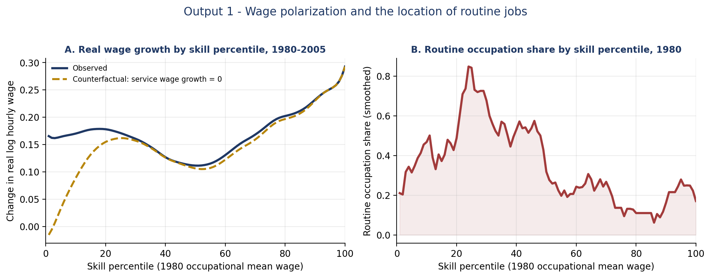
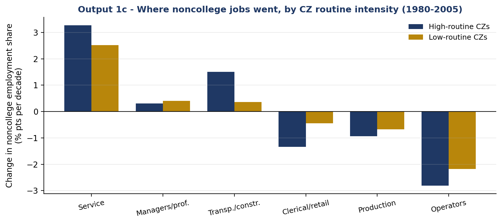
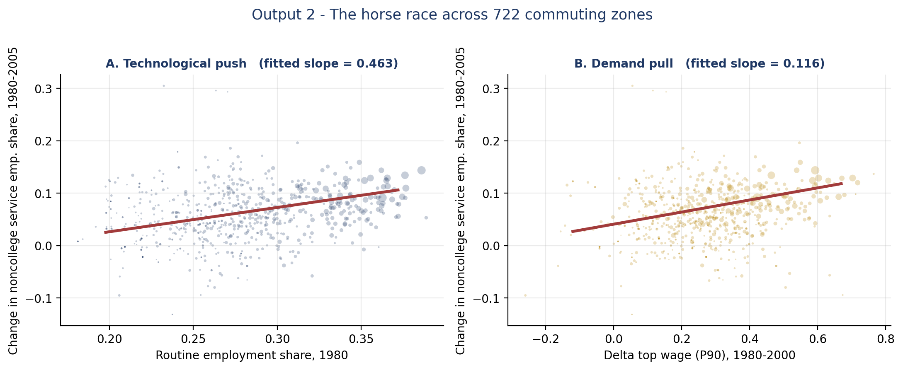

# Automation or Rising Wealth?

### A within-dataset horse race between technological push and demand pull in the growth of US low-skill service employment, 1980–2005

**Python for Economists — Track B (Corpus Analysis) — University of Bologna, AY 2025/2026**
**Group 17:** Olimpia Benelli · Carlotta Cosio · Tommaso Cotoloni · Matteo Tugu

📄 [Research proposal](docs/Research_Proposal.pdf) · 📊 [Results and commentary](docs/Results_and_Commentary.pdf)

---

## 📌 Research question

Between 1980 and 2005 the US labour market polarised: employment and wages grew at the top and bottom of the skill distribution and stagnated in the middle. The most striking change at the bottom is the rise of low-skill service jobs (food service, cleaning, security, personal care). Two explanations compete:

* **Story A — Technological push (Autor & Dorn, 2013).** Cheaper computing automates routine tasks, concentrated in middle-skill clerical and production jobs. Displaced non-college workers move into manual, hard-to-automate services.
  *Prediction:* commuting zones more specialised in routine work in 1980 see faster service-employment growth.
* **Story B — Demand pull (Moretti, 2010).** Rising local high incomes increase demand for in-person services (local multiplier).
  *Prediction:* commuting zones with faster top-wage growth see faster service-employment growth.

The literature tests these stories separately. **We put both in the same regression, on the same data**, and let them compete.

## 🗂 Data

Public replication package of **Autor & Dorn (2013)**, AEA Data and Code Repository / openICPSR, project **112652** ([doi:10.3886/E112652V1](https://doi.org/10.3886/E112652V1)).

* **Unit of observation:** US commuting zones (CZs), 722 local labour markets covering the mainland US.
* **Sample:** three stacked decadal changes, 1980–90, 1990–2000, 2000–05 → **2,166 CZ-period observations**.
* **Files used** (in `data/`): `workfile2012.dta` (CZ panel), `RTI-bypctile-1980.dta` (routine share by skill percentile), `dwg-byperc-1980-2005-czall.dta` (wage growth by skill percentile).
* The 1980 routine employment share has a population-weighted mean of 0.33 and an 80/20 range of 0.072.

## 🔬 Methodology

* **Dependent variable:** decadal change in the non-college service employment share.
* **Key regressors:** 1980 routine employment share (Story A); change in log P90 wage (Story B).
* **Estimation:** a "staircase" of five specifications. Columns (1)–(4) use population-weighted OLS. Column (5) uses **2SLS**, instrumenting the routine share with the 1950 industry-mix prediction (predetermined three decades before the sample), with the full Autor–Dorn controls and state and time fixed effects.
* Standard errors are clustered by state throughout.

## 📊 Results

### 1. Polarisation and where routine jobs sit



*Panel A: real wage growth is U-shaped across the skill distribution; setting service-occupation wage growth to zero (dashed line) removes the rise at the bottom, so services drive the lower tail. Panel B: routine work is concentrated in the lower-middle of the distribution, where wage growth is weakest.*



*In high-routine CZs, non-college employment shifts more strongly out of routine occupations (clerical/retail, production, operators) and into services.*

### 2. The horse race

Dependent variable: change in the non-college service employment share (standard errors in parentheses).

| | (1) RSH | (2) Demand | (3) Horse race | (4) + controls | (5) 2SLS-IV |
|---|---|---|---|---|---|
| Routine share (RSH) | 0.124*** (0.029) | – | 0.096*** (0.027) | 0.173*** (0.032) | 0.149*** (0.056) |
| Δ top wage (P90) | – | 0.048*** (0.013) | 0.037*** (0.013) | 0.012 (0.014) | – |
| Δ college labour supply | – | – | – | −0.110*** (0.029) | – |
| Offshorability | – | – | – | −0.005 (0.003) | – |
| State & time FE | No | No | No | No | Yes |
| 1950 instrument | No | No | No | No | Yes |
| N | 2,166 | 2,166 | 2,166 | 2,166 | 2,166 |

*Weighted by start-of-period CZ population; SEs clustered by state. \*\*\* p<0.01, \*\* p<0.05, \* p<0.10. First-stage F in column (5) = 174.*



*Both raw slopes are positive because the two mechanisms are correlated across space (routine-intensive CZs also had faster top-wage growth, correlation ≈ 0.29). This is why the regression, not the scatter, decides the race.*

### 3. Conclusion

The routine share is positive and significant in every specification. It survives the head-to-head with top-wage growth, the demand-side controls and instrumentation (0.149, matching Autor & Dorn's headline 2SLS estimate). Top-wage growth matters on its own but becomes insignificant once the routine share and controls are included, and college labour supply even enters negatively. **On this data, technological push, not demand pull, explains the cross-CZ growth of low-skill service employment.**

*Caveat:* the estimates are reduced-form and cross-regional; demand-pull effects may operate at other geographic scales or through channels not captured by P90 wage growth.

## 🚀 How to reproduce

Requires Python 3.11+.

```bash
git clone https://github.com/t-cotoloni/automation-vs-wealth.git
cd automation-vs-wealth
pip install -r requirements.txt
python trackB_analysis.py
```

The script reads the three `.dta` files from `data/` and writes all outputs (3 figures and the results table as CSV) to `outputs/`. For the step-by-step analysis with commentary, open the notebook:

```bash
jupyter notebook TrackB_AutorDorn.ipynb
```

## 📂 Repository structure

```
├── data/                       # Autor & Dorn (2013) replication files (.dta)
├── docs/
│   ├── Research_Proposal.pdf
│   └── Results_and_Commentary.pdf
├── outputs/                    # figures and results table produced by the script
├── TrackB_AutorDorn.ipynb      # step-by-step notebook
├── trackB_analysis.py          # end-to-end pipeline
├── requirements.txt
└── README.md
```

## 📚 References

* Autor, D. H. and Dorn, D. (2013). "The Growth of Low-Skill Service Jobs and the Polarization of the US Labor Market." *American Economic Review*, 103(5): 1553–1597.
* Moretti, E. (2010). "Local Multipliers." *American Economic Review*, 100(2): 373–377.
* Autor, D. H., Levy, F. and Murnane, R. J. (2003). "The Skill Content of Recent Technological Change." *Quarterly Journal of Economics*, 118(4): 1279–1333.
